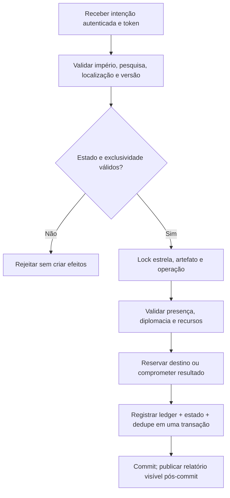

# STARZ — C3.0-D10: adjudicação de custódia e contratos de consistência

**Estado:** `APPROVED` como **design técnico** em 08/11/2026; decisões D10-A–H e critérios T33–T48 aprovados expressamente. **Não implementado; testes não executados.**  
**Autoridade:** [C3.0-D08 A–H](combat-stellar-disposition.md), [C3.0-D09 A–H e T17–T32](combat-stellar-custody.md), [C3.0-D07 A–H](combat-technical-contracts.md).  
**Propósito:** decidir quem pode reivindicar um núcleo selado, o que acontece quando o controle militar muda, como evitar claims e destinos concorrentes e que invariantes o schema deverá impor.  
**Fora do escopo:** implementação de gameplay, migrations, endpoints, frontend, regras numéricas finais, alianças ainda não existentes, PR, merge ou deploy.

## 1. Problema a fechar

A D09 **aprovou** que propriedade histórica, controle militar, custódia e destino são conceitos diferentes; a D08 **aprovou** que a vitória não transfere Stargrave operacional e que o destroço é seguro e persistente. Ainda faltam condições **executáveis e não ambíguas** para determinar **quando** o controlador militar pode obter a custódia e o que ocorre em guerras concorrentes.

**Diretriz geral proposta:** iniciar um claim **não concede posse**, e nenhum desempate por ID/horário pode converter automaticamente uma disputa militar legítima em propriedade. `claim_pending` é expectativa revogável/contestável, não titularidade; `in_custody` é compromisso persistente obtido após validação de presença e ausência de contestação elegível.

## 2. D10-A — controle local sem soberania fictícia (`APPROVED` como design)

**Recomendação:** derivar elegibilidade de reivindicação de **unidades militares reais presentes na localização atual do destroço**, não de dono do sistema por inferência, nome do mapa, proximidade visual ou vitória histórica.

- Um núcleo estacionário em **órbita de planeta** usa a identidade durável do planeta e a presença de unidades na mesma localização; um núcleo em **espaço de sistema** exige presença nesse local. Definir uma coordenada autoritativa para espaço livre **antes de implementar**, pois o motor atual não tem ocupação naval geral de todas as posições.
- O requerente precisa ter unidades militares operacionais autorizadas para aquele local **na abertura e na conclusão** do claim; não usar naves em trânsito nem estrutura em outro planeta.
- Naves de outros impérios no mesmo local **capazes de contestar de acordo com as regras de guerra/hostilidade existentes** tornam a posse disputada; não presumir aliança ou direito de compartilhamento inexistentes no servidor.
- Em território de império que não é o requerente, o próprio controle de guarnição/planeta **não é automaticamente substituído** por superioridade em uma batalha pontual. Sem regra de ocupação espacial, um claim ilegítimo deve ser recusado ou ficar sem progresso, em vez de criar soberania implícita.
- Reconhecimento visual do destroço não confere permissão de claim; requer propriedade, presença, guerra e autorizações verificadas no servidor.

**`OPEN`:** definição técnica de `free_space_location` e como modelar recuperação de destroço fora de planeta; tratamento de terceiros não hostis e tratados. Não criar essas mecânicas por presunção.

## 3. D10-B — elegibilidade e precedência de claims (`APPROVED` como design)

**Proposta para primeira versão:** permitir **um claim ativo por núcleo**; múltiplos pedidos válidos simultâneos competem por **reserva transacional**, mas a reserva apenas inicia a operação. Um rival que apareça com força militar válida pode **contestar e suspender** o claim.

- O pedido precisa citar `wreck_id` e `stellar_source_id` conhecidos, o império requerente e uma chave de idempotência.
- A abertura valida: `sealed_wreck`, janela mínima de estabilização concluída, nenhuma disposição comprometida, presença militar elegível, relação diplomática autorizadora e ausência de claim incompatível já comprometido.
- Se pedidos chegarem simultaneamente e só um puder ser reservado, o banco escolhe um **registro serializável**. Esse é desempate **operacional**, não direito definitivo do primeiro cronologicamente ou do menor ID.
- Claim reservado é **revalidado na conclusão**. Se houver força contestante válida ou o requerente perder elegibilidade, não se conclui custódia; o núcleo continua selado.
- O proprietário histórico não ganha automaticamente preferência especial contra uma força militar que tenha obtido custódia legitimamente; eventual direito de resgate exclusivo exige regra distinta.

**`OPEN`:** comportamento exato de claims suspensos (retomar ou reiniciar), necessidade de operações de guerra específicas para contestar, limitações de neutralidade.

## 4. D10-C — contestação e resolução sem microgerenciamento (`APPROVED` como design)

- Um claim tem três resultados semânticos: **concluído**, **interrompido/contestável**, **rejeitado**; não há resolução por sorte ou clique repetido. Estados e enums finais ficam sujeitos ao schema.
- Contestação depende de **presença militar combatível e regras já válidas de hostilidade**, não de um contador fictício de influência.
- Durante a contestação, a operação de custódia **não avança nem consome recursos irreversíveis adicionais**; cobranças antecipadas exigem escrow/reserva real e política de compensação.
- Após resolver disputa militar, a operação pode prosseguir **somente se** o requerente detiver o controle exigido. Um empate de combate ou presença adversária indefinida conserva destroço seguro; não desencadeia autodestruição por inatividade.
- É proibido transferir custódia automaticamente ao adversário que interrompeu a reivindicação. O novo controlador também precisa iniciar um claim legítimo.
- Não criar combate em tempo real por salva, nova pontuação de soberania ou transferência automática de planetas.

**Teste-chave:** dois impérios com claims sucessivos não podem produzir dois custodians, duas recompensas nem duas operações de destino válidas.

## 5. D10-D — custódia confirmada e perda subsequente de controle (`APPROVED` como design)

**Recomendação:** distinguir **custódia já confirmada** de **claim pendente**.

- O controle militar que legitimou a conclusão do claim fica no registro histórico. Uma captura do local **depois do commit** não altera `custodian_empire_id` retrospectivamente.
- Entretanto, operações de reconstrução/repatriação/descomissionamento que ainda exijam trabalho local **pausam ou se tornam inválidas** se o custodiante perder direito de operação no local. Titularidade/custódia histórica não equivale a poder executar ações sem presença.
- Um novo império não pode simplesmente editar `custodian_empire_id`. Deve utilizar fluxo futuro explícito de transferência, conquista de custódia ou abandono; **esse fluxo não está aprovado nem especificado na D09**.
- Sem fluxo de transferência definido, o núcleo mantém custódia registrada e fica bloqueado para novo destino até resolução legítima; nenhum timeout do custodiante gera concessão automática.

**`OPEN`:** se e como permitir transferência coercitiva de custódia após tomada da região, cessão consensual, perda de império e domínio neutro. Requer decisão separada, para evitar objetos irrecuperáveis.

## 6. D10-E — contrato mínimo de persistência e unicidade (`APPROVED` como arquitetura; nomes candidatos)

Usar o PostgreSQL autoritativo existente; entidades conceituais aprovadas em D07 são fronteiras, **não** obrigação de criar exatamente cinco tabelas.

| Agregado candidato | Identidade | Fatos persistidos | Restrição/invariante |
|---|---|---|---|
| **StellarSourceState** | `universe_id + canonical_star_id` | origem imutável, condição estelar, status de vínculo | Identidade durável única, nenhuma segunda captura |
| **StellarArtifact** | `stellar_artifact_id` | posição atual, categoria `wreck/core/relic/stargrave`, integridade/atividade, custodiante | Artefato não militar não dispara nem se move |
| **StellarCustodyOperation** | `operation_id` | claim, requerente, alvo, versão, estado, idempotency key, janela e observações | **Um claim comprometido por núcleo**; idempotência escopada por universo+império+operação |
| **StellarDispositionOperation** | `operation_id` | `rebuild/repatriate/decommission`, recursos reservados/consumidos, destino, estado | **Uma disposição ativa por núcleo**; estados terminais excluem alternativas |
| **StellarLedgerEntry** | chave de evento único | débito/crédito de componentes, combustível, salvamento e transporte | Mesmo evento não pode consumir ou conceder item duas vezes |

**Não duplicar a estrela entre agregados:** `StellarSourceState` é fonte única da identidade e vínculo; outros registros referenciam essa chave por FK/constraint. Um `artifact` é o invólucro físico do **mesmo núcleo**, não outra estrela.

**Constraints conceituais necessárias:**
- Unicidade global por universo da identidade de estrela e de cada artefato ativo.
- Exclusividade de vínculo ativo por estrela e por Stargrave/núcleo; adaptar a modelo com estado histórico sem liberar origem prematuramente.
- Índice único parcial por `stellar_artifact_id` em operações de custódia/disposição de status **ativo/comprometido**.
- Dedupe por `idempotency_key` escopada a operação e requerente, com rejeição de reuso da mesma chave para payload conflitante.
- `row version`/lock na transição, FK no mesmo universo e transação que atualiza estado e ledger.
- Estado terminal imutável a reprocessamentos; reconstrução só cria/reativa **uma** unidade com a estrela existente.

**`OPEN`:** nomenclatura, índices e tabelas reais, modo de lock, fronteiras do ledger e tratamento de serialização/isolamento conforme o código PostgreSQL atual; é obrigatório validá-los antes de migrations.

## 7. D10-F — evento de liquidação e fluxos de recuperação (`APPROVED` como design)

Propor **um evento de domínio atômico por mudança de custódia/destino**, idempotente ao reprocessar `settle` ou worker offline.

- A transação que conclui custódia ou destino deve incluir mudança de estado, marca de dedupe e débito/crédito real. Falha antes do commit não produz meia-entrega; retry depois retorna o resultado já comprometido.
- Reconstrução registra consumo por etapa e só reativa Stargrave após comissionamento; cancelamento devolve **apenas recursos não consumidos**.
- Repatriação mantém `origin_system_id` e `current_location` distintos, trajeto/ETA reais, combustível/reserva reais e reintegração da estrela somente na chegada final.
- Relíquia selada mantém estrela/vínculo histórico, sem produção, movimento, recaptura ou bônus militar.
- Ordens de núcleo em trânsito também precisam de idempotência e prevenção de dois destinos concorrentes; um evento de falha não teleporta a estrela.
- Não usar `UniverseOrder` com conteúdo arbitrário sem validar compatibilidade: adaptar a contratos versionados de missão/operacionalização da D07, sem gravar duplicadamente resultados entre `payload` e tabelas de custódia.

## 8. D10-G — critérios técnicos de adversarialidade (`APPROVED` como QA futuro)

Amplia os casos **T01–T32** aprovados como QA documental. Os casos **T33–T48 também estão `APPROVED` como critérios de aceitação**, **sem testes executados**.

| ID | Situação adversarial | Resultado obrigatório |
|---|---|---|
| **T33** | Dois claims simultâneos de impérios elegíveis | Uma reserva ativa, nenhum título definitivo sem conclusão legitimada |
| **T34** | Rival chega no último tick antes do claim concluir | Revalidar controle e suspender claim contestado |
| **T35** | O mesmo pedido é reenviado com a mesma idempotency key | Resposta estável, sem segunda operação ou custo |
| **T36** | Mesma idempotency key com payload diferente | Rejeitar conflito sem alterar estado |
| **T37** | Perda de controle antes da conclusão | Nenhuma custódia transferida; núcleo preservado |
| **T38** | Perda de controle depois da conclusão | Custódia histórica não é alterada retroativamente; operação nova revalidada |
| **T39** | Um terceiro tenta modificar custodian sem procedimento | Rejeitar, registrar tentativa e manter vínculo |
| **T40** | Dois destinos reservados em transações concorrentes | Apenas um commit válido por núcleo |
| **T41** | Cancelamento após consumo de parte dos materiais | Não restituir material já gasto, nem cobrar duas vezes |
| **T42** | Commit de destino confirmado, resposta do worker perdida | Replay encontra resultado único, sem segunda recompensa |
| **T43** | Lock FK em universo diferente | Impedir link de estrela/artefato entre universos |
| **T44** | Salvar e reabrir servidor com sealed wreck offline | Mesmo estado, nenhuma destruição automática |
| **T45** | Dois destinos tentam movimentar mesmo núcleo | Um trajeto real; segunda missão recusada |
| **T46** | Reinstalação seguida de regeneração procedural | Uma estrela com identidade original, sem estrela fantasma |
| **T47** | UI adversária consulta operação de custódia privada | Não divulgar credenciais, pesquisas ou estado reservado não autorizado |
| **T48** | Undo/rollback de migração com operação pendente | Não perder vínculo, destino, ledger nem ordens comprometidas |

## 9. D10-H — portas de decisão antes da implementação (`APPROVED` como planejamento)

**Gate de design:** D10-A–G estão `APPROVED` como design; permanece necessário definir localização autoritativa em espaço livre e transferência de custódia previamente confirmada. Ver [C3.0-D11](combat-custody-transfer.md) (`PROPOSED`). Não deixar esses detalhes para um `if` improvisado.

**Gate de dados:** identificar chave canônica de estrela no gerador de sistemas de estrela única; escolher agregados mínimos, chaves, índices/constraints e tipos reais; garantir leitura de saves sem entidades novas.

**Gate de transação:** resolver commits concorrentes e retries idempotentes com locking/versão, compensações de recursos e recuperação após crash; nenhuma transição destrutiva por padrão.

**Gate de UI:** apresentar opções contextuais existentes (reivindicar, contestar, recuperar, repatriar, descomissionar), com condicionais do servidor e sem inventar soberania ou dados privados.

**Gate de QA:** validar C3.0-D04 B01–B18, D07 T01–T16, D09 T17–T32 e D10 T33–T48 conforme escopo e autorização. D08-F continua cenários experimentais, sem parâmetros de produção aprovados.

Nenhuma dessas atividades executáveis está autorizada apenas por esta D10.

## 10. Registro das decisões D10 aprovadas

| ID | Decisão **`APPROVED` como design** |
|---|---|
| **D10-A** | Controle militar é presença autoritativa real no local; vitória histórica/mapa não basta |
| **D10-B** | Um claim ativo por núcleo; reserva transacional é disputa temporária, não propriedade |
| **D10-C** | Contestação militar suspende/impede a conclusão; sem transferência de custódia automática |
| **D10-D** | Custódia concluída é fato histórico; perder região pausa operações e exige transferência explícita |
| **D10-E** | Agregados/constraints mínimos com identidade estelar exclusiva, dedupe e ledger |
| **D10-F** | Claims, recursos, transporte e destinos usam operações atômicas/idempotentes |
| **D10-G** | Cenários adversariais T33–T48 como critérios de QA técnico |
| **D10-H** | Gates de schema, transação, UI e QA antes de qualquer implementação |

**`APPROVED`** como design: D10-A–H e T33–T48, **sem implementação nem execução**. **`OPEN` após aprovação:** tratamento de regiões em espaço livre, transferência de custódia por conquista/cessão, impérios extintos, aliados/neutros, limites temporais/numéricos, custódia de relíquia e destinação planetária após reinstalação. Esses são problemas reais a fechar, não permissões implícitas para inventar regras no código.

## 10.1. Proposta posterior — transferência de custódia

A [C3.0-D11](combat-custody-transfer.md) está **`APPROVED` como design** e fecha funcionalmente as lacunas que não foram escolhidas pela D10: transferência legítima de custódia já confirmada, cessão consensual, império extinto, espaço livre e neutralidade. As regras **D10-A–H e T33–T48** estão aprovadas; **D11 foi aprovada expressamente pelo responsável**; persiste revisão do schema e parâmetros.

## 11. Referências

- [D09 aprovada](combat-stellar-custody.md); [D08 aprovada](combat-stellar-disposition.md); [D07 aprovada](combat-technical-contracts.md); [registro](combat-3-decisions.md).
- [Stargrave](stargrave.md), [combate](combat.md), [balanceamento](balance.md), [catálogo de design](README.md).
- [Modelo PostgreSQL](../../starz/db/models.py), [ordens/missões](../../starz/persistent/service.py), [motor de combate](../../starz/persistent/combat.py).

**Estado final: `APPROVED` como design técnico; T33–T48 aprovados como critérios futuros, não executados.** Schema/nomes definitivos, custos, prazos, transferência de custódia por conquista/cessão e espaço livre continuam `OPEN`; ver [C3.0-D11](combat-custody-transfer.md), `PROPOSED`. Nenhum gameplay foi alterado.
