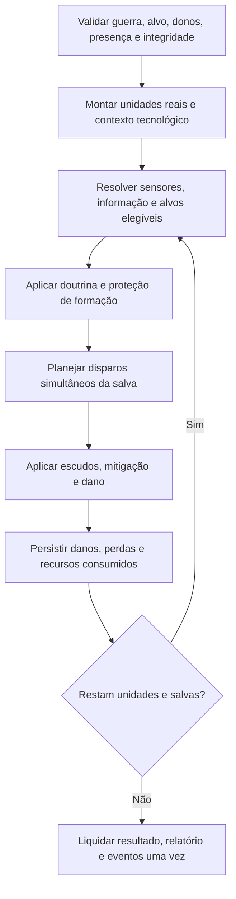

# STARZ — Combat 3.0: doutrinas, formações e resolução de combate

**Estado:** `PROPOSED` — proposta de design para discussão, não autorização de gameplay.  
**Dependência:** [Research 3.0 — identidades aprovadas](research-3.md) e [contratos operacionais propostos](research-operational.md).

## 1. Objetivo

Tornar composição naval, reconhecimento, doutrina, escolta e contramedidas escolhas estratégicas significativas, sem transformar o combate em microgerenciamento por nave. Preservar naves reais, hulls, estados de dano, localizações e economias atuais.

## 2. Base `IMPLEMENTED`

- Frotas guardam `ship_ids` reais; propriedade e co-localização são verificadas no servidor.
- O combate persistente em `starz/persistent/combat.py` resolve até seis salvas; planos são calculados antes de aplicar as perdas da mesma salva. Dano de casco é persistente.
- Ataques usam modificadores por `combat_class`, dano por `weapons`, escudos e mitigação `armor`; armamento embarcado de Atlas usa capacidade abstrata.
- Missões e ordens persistentes são gerenciadas por `starz/persistent/service.py`; inteligência/contrainteligência por `starz/persistent/intelligence.py`.
- A Stargrave não é um hull convencional construível. **Não** implementar subsistemas estelares por simples modificação de `dominion_hull`.

## 3. Princípios de design `PROPOSED`

1. Uma **doutrina por frota**, com valor padrão neutro; sem comandos individuais por nave e sem necessidade de intervenção em cada salva.
2. Funções de classe são capacidades verificáveis, não nomes de `role` nem multiplicadores indefinidos.
3. Doutrinas redistribuem foco/cobertura, mas não criam HP ou dano gratuitamente.
4. Toda especialização tem custo de oportunidade, vulnerabilidade e telemetria no relatório.
5. Reconhecimento aumenta a qualidade da informação, mas não consulta estado privado do oponente sem autorização mecânica.
6. A decisão do combate é autoritativa, reproduzível e atomicamente persistida.
7. O modo padrão deve manter comportamento compatível com saves atuais e sem pesquisas novas.

## 4. Doutrinas predefinidas — proposta inicial

| Doutrina de UI (não ID executável) | Seleção prioritária | Trade-off / função |
|---|---|---|
| Equilibrada (padrão) | Política de alvo normal | Sem vantagens especiais nem configuração obrigatória |
| Interceptação | Ameaças leves e antiescolta | Reduz foco em capitais enquanto existem ameaças elegíveis |
| Ruptura | Unidades blindadas/capitais e escudos quando descobertos | Pode desperdiçar esforço contra enxames e alvos inadequados |
| Proteção | Prioriza cobertura de naves de suporte e logística | Reduz liberdade ofensiva da formação |

Estas quatro opções são candidatas. Não fixar percentuais, prioridades exatas, regras de empate ou IDs de enum sem aprovação. Uma doutrina só pode selecionar alvos legalmente detectáveis/presentes.

## 4.1. Refinamento C3.0-D01 — escolta e proteção

`PROPOSED`: [C3.0-D01 — escolta, formações e proteção](combat-formations.md) aprofunda o redirecionamento limitado de disparos, a elegibilidade real de Vanguard/Sentinel/Aegis, o tratamento da guarnição e a simultaneidade das salvas. Ele **recomenda** três doutrinas ofensivas, sem a candidata Proteção, mas essa escolha ainda não é `APPROVED`. O detalhamento continua sem autorização para gameplay.

## 5. Formação e escolta

**Proposta:** separar papéis (escolta, linha, suporte) dos hulls de forma derivada. `fleet_coordination` habilita a aplicação funcional; hulls atuais conservam requisitos de construção.

- Vanguard: escolta leve, protege funções vulneráveis contra ameaças leves.
- Sentinel: defesa e interceptação elegível, sujeita a munição/capacidade quando a regra específica existir.
- Aegis: proteção de linha; eventual coordenação de escudo exige contrato novo (não presumir compartilhamento hoje).
- Spearhead/Leviathan: pressão ofensiva e alvos capitais; sem imunidade a unidades leves.
- Horizon/Odyssey/Wayfarer: reconhecimento, ciência e logística, quando presentes; não criar capacidades fictícias em combate.
- Atlas: suporte de alas conforme modelo autoritativo; Dominion: coordenação quando esta mecânica vier a existir.

A proteção não cria naves abstratas. Perda de escoltas remove cobertura na próxima etapa de resolução aplicável. O resultado não deve violar a regra existente de planejamento simultâneo de salvas.

## 6. Pipeline de resolução proposto

**Atenção:** a engine atual planeja os dois lados antes de aplicar as perdas; o novo pipeline não autoriza mudar essa simultaneidade silenciosamente. Tampouco se deve introduzir aleatoriedade não reproduzível.

## 7. Guerra eletrônica e inteligência

- `electronic_warfare` contesta aquisição de alvos e qualidade de relatórios.
- Oportunidade de reconhecimento pode permitir políticas mais precisas, sem revelar automaticamente informações privadas.
- `counter_intelligence` e `sensor_array` mantêm função efetiva; eventuais novos modificadores exigem contratos e comparação com o modelo de razão/qualidade existente.
- O alvo deve ser elegível pela informação válida no momento do confronto; não derivar HP invisível do frontend.

## 8. Escudos, ruptura e Stargrave

- `shield_disruption` define perfil contra escudos com custo de oportunidade, sem bypass absoluto.
- `containment_warfare` define a elegibilidade de atacar subsistemas estelares identificados, mantendo ataques convencionais possíveis.
- Stargrave tem núcleo, escudos, propulsão, controle e armamento como **subsistemas propostos**, com efeitos degradáveis. Dano não causa destruição automática do planeta ou explosão inevitável da estrela.
- Interdição regional tem contrato distinto de disparos e não deve paralisar a nave adversária indefinidamente.
- Equivalência de poder, janela de bombardeio, consumo de energia e perda de subsistemas continuam `OPEN`.

## 9. Relatório e interface

Mostrar doutrina, composição antes/depois, quantidade de alvos protegidos, condições de aquisição, ataques absorvidos por cobertura, dano por tipo e efeitos de tecnologia **somente quando calculados pelo servidor**. Jogadores não recebem detalhes ocultos do inimigo que não obtiveram por inteligência legítima.

A seleção de doutrina deve ser compacta e fazer parte da gestão de frota existente, não de um painel de nave por nave.

## 10. Critérios de validação futura

- Salva simultânea permanece correta; mesmas condições produzem mesmo resultado.
- Doutrina neutra conserva comportamento compatível com o combate anterior.
- Escolta ausente, destruída ou fora do sistema não protege.
- Guerra eletrônica pode ser contestada e não apaga relatórios legados.
- Perfil antiescudo apresenta custo de oportunidade contra alvos sem escudo.
- Unidades convencionais preparadas podem danificar/derrotar Stargrave em cenários adequados.
- Nenhuma unidade, estoque, munição ou dano é contabilizado duas vezes em resolução offline.
- Não abrir combat round microgerenciamento nem exigir novas filas por nave.

## 11. Questões `OPEN`

- Quantas doutrinas lançar? A opção Proteção é necessária ou a formação já cobre essa função?
- Como selecionar entre alvos sob informação incompleta e empates sem viés indesejado?
- Proteção deve redirecionar ataques, reduzir dano, ou ambos? Não decidir simultaneamente antes de comparar alternativas.
- Que função de combate mínima é necessária para cada uma das dez classes?
- Como medir custo de oportunidade da ruptura de escudos?
- Quando a janela de interdição afeta lançamento versus chegada e quais contramedidas a neutralizam?
- Qual interface/relatório oferece clareza sem revelar dados de outro jogador?

**Não executar código ou alterar catálogos com base neste documento.** A próxima etapa é aprovação dos princípios e escolha das regras mínimas, seguida de cenários de simulação em [balance.md](balance.md).
