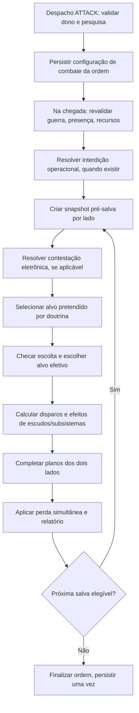

# STARZ — C3.0-D05: integração técnica e registro de decisões

**Estado:** `APPROVED` como contrato de arquitetura e plano futuro (08/11/2026); **não implementado**. Questões ainda sem escolha definida continuam `OPEN`. Ver [registro consolidado](combat-3-decisions.md).  
**Branch de referência:** `experiment/persistent-universe`.  
**Autoridade:** [C3.0-D01 — formação](combat-formations.md), [C3.0-D02 — targeting](combat-targeting.md) e [C3.0-D03 — contramedidas](combat-countermeasures.md) estão `APPROVED` como design; [C3.0-D04 — balanceamento](combat-balance-plan.md) está aprovado como plano sem execução.  
**Risco da alteração atual:** baixo, documental. Nenhum comportamento executável ou dado persistido é modificado.

## 1. Objetivo

Conectar capacidades de Research 3.0 ao resolvedor de combate, às ordens persistentes e aos relatórios, preservando o comportamento atual para frotas sem tecnologias/configurações novas. Definir fronteiras dos sistemas, pontos de decisão e uma ordem de trabalho **futura**, condicionada à aprovação expressa.

**Proibido inferir aprovação:** «pode seguir» autoriza continuação documental e não transforma detalhes de C3.0-D02/D03 em requisitos aprovados nem autoriza código, PR, merge ou deploy.

## 2. Contratos verificáveis em código hoje (`IMPLEMENTED`)

| Componente atual | Contrato observado | Dependência de design |
|---|---|---|
| `starz/persistent/combat.py:plans` | Escolhe alvo por `(weapon_modifier[class], -hp, id)` com HP/escudos projetados e pool planetário simplificado | C3.0-D02: separar alvo pretendido do efetivo sem romper ranking neutro |
| `combat.py:apply_hits` | Consome reserva coletiva de escudo defensivo, depois escudo da unidade e casco mitigado por armadura | C3.0-D01/D03: redirecionamento e antiescudo não criam dano/escudos extras |
| `combat.py:resolve_battle` | Planeja os dois lados antes das perdas, até seis salvas; persiste perdas e HP | Preservar simultaneidade, vitória, saque, relatórios e idempotência |
| `combat.py:local_defenders` | Reúne naves presentes no **planeta** de defesa, inclusive múltiplas frotas próprias | C3.0-D01: cobertura de guarnição, sem proteção interplanetária |
| `starz/persistent/service.py:dispatch` | Valida nave/dono/posição, missão, combustível, guerra e frota; cria uma `UniverseOrder` para missão | C3.0-D02: política de alvo da frota deve integrar ordem sem afetar saves legados |
| `service.py:resolve` | Na chegada, revalida guerra e usa `resolve_battle`; depois registra retorno conforme missão | Doutrina/configurações não podem reescrever retrospectivamente ordens em trânsito |
| `starz/persistent/intelligence.py` | Relatórios privados de qualidade 0–3 com expiração, sem atualização clandestina | C3.0-D03: interferência só sobre nova aquisição de inteligência |
| `starz/db/models.py:UniverseOrder` | Evento `kind`, `payload`, `due_at` e `resolved` em PostgreSQL | Contrato de campos/versionamento opcional, idempotente e compatível |
| `persistent_data/ships/functions.yaml` | Classes `light/medium/capital`, atributos e roles; Stargrave sem hull convencional | Não criar entidade Stargrave como Dominion ampliada |

**Diferença importante:** `plans` usa projeção aproximada para escolher candidatos e `apply_hits` aplica absorção real. Não presumir que a projeção atual é um simulador exato de escudos planetários, casco ou overkill. Também não modificar essa semântica para a doutrina Equilibrada sem um requisito explícito.

## 3. Pipeline de integração aprovado como arquitetura (`APPROVED`)

O fluxograma representa **dependências de design**, não chamadas de código existentes. Em particular, um bloqueio operacional/interdição **não** deve simular seu resultado criando um disparo no motor naval.

### 3.1. Invariantes de planejamento

- Cada disparo tem **um atirador**, **um alvo pretendido**, **um alvo efetivo** e **um orçamento de dano/munição**.
- Redirecionar não produz segundo disparo, não reexecuta a doutrina nem inicia uma cadeia de redirecionamentos.
- O modificador de classe deve considerar o **alvo efetivo**, mas somente quando o contrato de redirecionamento se aplicar.
- Na mesma salva, o estado de ambos os lados é derivado de snapshots **anteriores às perdas**; a escolta destruída por ataque inimigo ainda pode ter um redirecionamento já planejado.
- No início da salva seguinte, recalcular elegibilidade, integridade e disponibilidade de escoltas.
- A escolha de alvo não divulga tecnologias/estoques privados por si só.

### 3.2. Três fronteiras separadas

| Fronteira | Responsabilidade | Não autoriza |
|---|---|---|
| Seleção | Doutrina + contestação eletrônica determinam **quem** é alvo pretendido | Dano adicional ou leitura de informação extrabatalha |
| Proteção | Escolta aprovada decide **se** muda o alvo efetivo | Escudo compartilhado ou imunidade |
| Aplicação | Perfil de arma e proteções reais determinam **como** o disparo produz dano | Duplica hits, munição, pool ou HP |

A pesquisa `containment_warfare` concede capacidade de **selecionar subsistemas elegíveis**, não permissão exclusiva para danificar Stargrave. A `spatial_interdiction` opera fora do loop de disparos.

## 4. Compatibilidade de saves, missões e guarnições

### 4.1. Doutrina — contrato candidato

- `APPROVED`: existem somente **Equilibrada, Interceptação, Ruptura** como escolhas de design; proteção é automática quando há `fleet_coordination`.
- `PROPOSED`: selecionar a doutrina ofensiva no despacho e registrá-la como campo opcional **versionado** na ordem `ATTACK`, não por um novo registro paralelo por nave.
- `PROPOSED`: ausência de campo, valor legado ou pesquisa insuficiente retorna **Equilibrada** com resultado compatível; não migrar destrutivamente ordens antigas.
- `PROPOSED`: quando há guarnição defensora composta por diversas frotas, aplicar Equilibrada ao tiro da guarnição na primeira versão, mas **preservar a cobertura cooperativa aprovada**.
- `OPEN`: se doutrinas individuais defensivas futuramente serão agregadas, que política prevalece e quando podem ser alteradas.

**Não definir ainda nomes executáveis de campos, enums ou endpoints.** A escolha do armazenamento exige contrato e teste de ida/volta de serialização, status e propriedade.

### 4.2. Operações em trânsito

- O despacho captura a política autorizada da operação; chegada deve revalidar guerra e existência de participantes, respeitando o contrato atual.
- A ausência de nova tecnologia/configuração não invalida uma missão antiga.
- Divisão, retorno, destruição, troca de status ou alteração de frota entre despacho e chegada não podem clonar bônus nem permitir trocar a doutrina para atacar com outra condição.
- Ordem já resolvida não recebe combate ou cobrança adicional após replay; recuperação offline deve manter ordenação de timestamps por `UniverseOrder`.

### 4.3. Defesa planetária

- Cobertura de escolta aprovada combina naves do **mesmo império presentes no planeta atacado**. Estações, baterias e escudos planetários continuam unidades/recursos separados.
- Efeitos sobre `planetary_shield` consomem **uma única reserva** de energia/carga; o relatório pode indicar absorção coletiva e individual sem contabilizar a mesma absorção duas vezes.
- Alvos `capital` no algoritmo atual **incluem certas estruturas defensivas** por classificação, não apenas naves capitais. A proposta de Ruptura exige deliberação explícita sobre estruturas pesadas antes de implementar.
- `missile_interceptor` e `resolve_missiles` não recebem automaticamente novas interações navais ou estelares.

## 5. Fronteiras de persistência por fase

| Capacidade | Estado necessário | Onde deve viver conceitualmente | Gate |
|---|---|---|---|
| Doutrina de alvo | Política selecionada para missão ofensiva | Contexto opcional da ordem e/ou frota; resolver fonte única | Aprovar C3.0-D02 e definir compatibilidade |
| Escolta | Composição elegível, contagem por salva | **Efêmero no snapshot da batalha**, sem salvar posições 3D | C3.0-D01 aprovada; algoritmo e testes pendentes |
| Guerra eletrônica | Pesquisa, emissor elegível, aquisição contestada | Operação real + snapshot da salva/observação | Aprovar C3.0-D03 e escolher emissor |
| Perfil antiescudo | Opção da frota, consumo real de dano | Configuração da missão + absorção autoritativa | Aprovar C3.0-D03 e seus trade-offs |
| Interdição | Emissor, cobertura, status, ETA/efeito | Evento/ordem regional persistente e idempotente | Contrato específico de início/fim e gatilho |
| Guerra de contenção | Subsystem alvo, conhecimento autorizado e dano | Contrato de Stargrave com entidade/módulos próprios | Modelar Stargrave antes de codificar |
| Relatório | Doutrina aplicada, ataques redirecionados, dano efetivo e sigilo | Relatório atual de combate com extensão opcional | Aprovar campos e níveis de visibilidade |

A tabela **não** cria schema. Não alterar `EmpireProgress`, `UniverseOrder`, `PlanetDefenseState` ou catálogos apenas por existir uma coluna nesta tabela.

## 6. Conflitos e decisões explícitas

| Registro | Conflito ou lacuna concreta | Parecer `PROPOSED` |
|---|---|---|
| **INT-01** | A C3.0-D02 prioriza `capital`; o motor classifica certas estruturas de defesa pesadas como `capital` | Preservar classificação durante seleção inicial; medir contra ataque a plataformas antes da aprovação |
| **INT-02** | A projeção de `plans` difere da absorção de `apply_hits`; escolta usa alvo efetivo | Recalcular projeção **somente dentro do novo caminho**, com controle de consumo; preservar baseline de Equilibrada sem novas pesquisas |
| **INT-03** | A C3.0-D01 exige 1 redirecionamento por escolta/salva; múltiplas frotas defendem juntas | Agrupar por planeta e proprietário, rastrear uso por ID de nave e salva, não por ID de frota |
| **INT-04** | A C3.0-D03 pressupõe emissor de interferência inexistente | Especificar explicitamente hull, módulo ou estrutura habilitadora antes de qualquer implementação |
| **INT-05** | Um perfil antiescudo aumenta número de controles | **Máximo uma opção de perfil ofensivo por frota**, decidida no despacho e independente da doutrina; comparar complexidade de UX |
| **INT-06** | `UniverseOrder.due_at` reconcilia eventos; interdição pode reprogramar chegadas | Não usar loops ou adiamentos infinitos; exigir transições idempotentes e critério de término |
| **INT-07** | Não há estrela capturada/subsistemas de Stargrave executáveis | Não representar Stargrave por hull legado nem produzir simulação numérica falsa; modelo persistente separado |
| **INT-08** | O relatório de batalha pode revelar atributos não confirmados | Exibir eventos observáveis e resultado do próprio império; privacidade de tecnologia/estoque inimigo deve ser explicitamente validada |

## 7. Sequência incremental aprovada como planejamento — não autorizada para codificação

| Etapa | Escopo futuro | Dependências | Risco de implementação |
|---|---|---|---|
| **P0** | Capturar baseline do combate atual em fixtures isoladas, sem mudar motor | Aprovar plano técnico e execução de testes | Baixo a médio |
| **P1** | Doutrina Equilibrada sem regressão, Interceptação/Ruptura e escoltas reais | Fechar C3.0-D02 + regras algorítmicas C3.0-D01 | Alto: motor compartilhado |
| **P2** | Interferência em novas observações, guerra eletrônica em targeting e antiescudo | Fechar C3.0-D03 + emissor + arma e trade-offs | Alto: inteligência e combate |
| **P3** | Interdição regional persistente | Fechar elegibilidade, janela, ETA e cancelamentos | Alto: transações, fila e offline |
| **P4** | Modelo da Stargrave e tiro contra subsistemas | Contrato de captura/contenção e entidade persistente própria | Muito alto: esquema e regras estratégicas |
| **P5** | Balanceamento sistemático da C3.0-D04 | P0–P4 conforme cobertura dos cenários | Variável |

Nenhuma dessas etapas foi autorizada como tarefa executável. Seleção de testes local por risco segue [política de QA](../development/local-qa.md); não criar GitHub Actions ou usar CI como substituto de validação local.

## 8. Registro de decisões aprovadas e abertas

### C3.0-D02: A–G `APPROVED`
- **A:** Interceptação prioriza `light`, fallback Equilibrada.
- **B:** Ruptura prioriza `capital > medium > light`, sem bônus de dano.
- **C:** manter ranking determinístico legado dentro da classe; Equilibrada compatível.
- **D:** alvo pretendido → escolta única → alvo efetivo → dano real.
- **E:** guardar doutrina no despacho, fallback Equilibrada para saves e guarnição.
- **F:** informação privada não deve ser inferida da seleção de alvos da batalha.
- **G:** preservar salvas simultâneas, munição, relatório e replay.

### C3.0-D03: A–G `APPROVED`
- **A:** interferência contesta prioridade especializada sem negar disparos.
- **B:** reduzir qualidade somente de novas observações, mantendo 0–3/expiração.
- **C:** antiescudo opcional por frota com desvantagem contra casco.
- **D:** interdição em zona limitada, sustentada e neutralizável.
- **E:** tiro dirigido em subsistema conhecido/exposto, sem dano duplicado.
- **F:** vulnerabilidade convencional de Stargrave e subsistemas degradáveis.
- **G:** simultaneidade, segurança, sigilo, idempotência e logs.

### C3.0-D05: INT-A/C/E definidas; INT-B/D `OPEN`
- **INT-A (`APPROVED`):** sim, estruturas defensivas atualmente classificadas como `capital` continuam elegíveis ao foco Ruptura. Medir o efeito em balanceamento.
- **INT-B (`OPEN`):** qual entidade real emite guerra eletrônica: hull existente, instalação, módulo ou operação? Nenhuma alternativa escolhida.
- **INT-C (`APPROVED`):** perfil antiescudo opcional da frota capturado no despacho da ordem `ATTACK`, sem escolha por salva.
- **INT-D (`OPEN`):** interdição atua no lançamento, entrada regional ou chegada? Qual máximo de adiamentos? Nenhuma alternativa escolhida.
- **INT-E (`APPROVED`):** guarnição usa Equilibrada na primeira versão; escoltas cooperam conforme C3.0-D01.

**Aprovações das C3.0-D01 a D05 não autorizam implementar.** INT-B/D, fórmulas, schemas, parâmetros e modelo persistente da Stargrave continuam `OPEN`, não `IMPLEMENTED`.

## 9. Critérios de saída para implementação futura

- D02 e D03 `APPROVED` como design; INT-A/C/E decididas; INT-B/D ainda precisam de definição expressa.
- Contrato de persistência de doutrina, consumo antiescudo e interdição formalizado, versionado e compatível.
- Testes planejados para legado byte/semanticamente equivalente, escolta por salva, escudos de bateria, munição, ownership, replay offline e sigilo de relatórios.
- Para Stargrave, requisitos de modelo persistente, vínculo único à estrela, subsistemas e recuperação definidos antes de testes de dano.
- Cenários e métricas da [C3.0-D04](combat-balance-plan.md) ligados a cada mudança operacional.
- Plano de rollback e migração não destrutiva aprovado separadamente.

Até lá, esta documentação apenas prepara a tomada de decisão.

## 10. Referências

- [C3.0-D01 — aprovado](combat-formations.md), [C3.0-D02](combat-targeting.md), [C3.0-D03](combat-countermeasures.md), [C3.0-D04](combat-balance-plan.md).
- [Combate atual](combat.md), [Pesquisa 3.0](research-3.md), [Stargrave](stargrave.md), [Balanceamento](balance.md).
- [Motor naval](../../starz/persistent/combat.py), [serviço e transações](../../starz/persistent/service.py), [inteligência](../../starz/persistent/intelligence.py), [ordens](../../starz/db/models.py).
