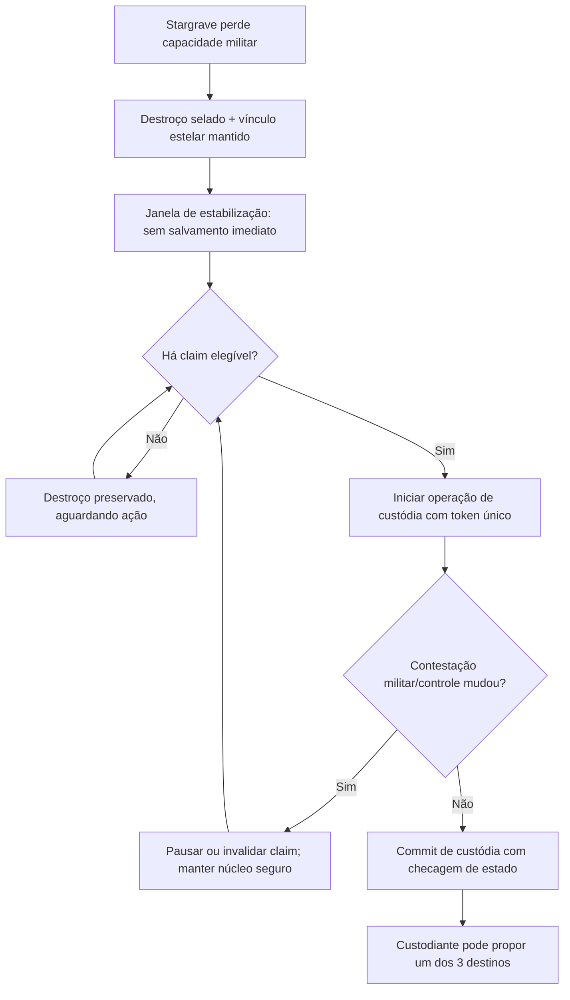

# STARZ — C3.0-D09: contrato técnico de custódia, recuperação e liquidação estelar

**Estado:** `PROPOSED` — especificação técnica para aprovação futura, **não implementada**.  
**Autoridade `APPROVED`:** [C3.0-D08 A–H](combat-stellar-disposition.md) (núcleo seguro, custódia disputável, três destinos e matriz apenas experimental), [C3.0-D07 A–H](combat-technical-contracts.md) (versão, atomicidade, vínculo estelar 1:1, adaptador e rollback) e [C3.0-D06 F/G](combat-operational-closures.md) (cinco fases, subsistemas e derrota).  
**Escopo:** decisões sobre **protocolo**, estados de custódia, contestação, operações logísticas, reembolso/saque, commit idempotente, integração ao mapa, visibilidade e QA.  
**Limite:** nomes de campos, enums, payloads e entidades são **candidatos**, sem migração, API, frontend, YAML ou gameplay autorizado. Nenhum custo/prazo/HP ou porcentagem é final.

## 1. Invariantes herdadas — não reabrir

- **Uma estrela** com ID durável por sistema de origem de estrela única; **no máximo um vínculo ativo** por astro, projeto ou Stargrave.
- A derrota militar desativa a Stargrave, mas conserva o núcleo em selagem passiva sem cronômetro de destruição.
- O vencedor **não** recebe automaticamente uma Stargrave armada, estrela transferida ou produção de energia.
- Há **três** destinos excludentes após operação legítima: **reconstruir** (mesma estrela), **repatriar fisicamente** ao sistema de origem ou **descomissionar** como relíquia selada.
- Sem catástrofe planetária obrigatória, sem alterar identidade/posição de sistemas e planetas, sem restauração automática de recursos.
- Captura inicial apenas em sistema descoberto, desabitado, não natal e **de estrela única**; concorrência com colonização bloqueada na transação.
- A matriz numérica C3.0-D08-F foi aprovada **como experimento**, não como valores configuráveis de produção.
- Não criar segundo resolvedor naval, novo `hull` convencional, duplicação de carga ou mini-jogo de tempo real.

## 2. D09-A — distinguir propriedade, custódia e controle regional (`PROPOSED`)

**Quatro identidades distintas:**

| Conceito | Significado proposto | Ação habilitada |
|---|---|---|
| Proprietário original | Império responsável pela unidade antes da derrota | Direitos de histórico, identificação e eventual contestação; **não** reativa a nave |
| Controlador regional | Império com presença militar válida na localização do destroço | Pode tentar reivindicar o núcleo quando a janela de estabilização se encerra |
| Custodiante | Império que concluiu uma **operação de custódia validada** | Pode iniciar **uma** disposição permitida, se possui pesquisas/infraestrutura necessárias |
| Destinatário final | Império/local que recebe núcleo reparado, estrela repatriada ou relíquia | Só recebe direito quando o destino comprometeu sucesso transacional |

A vitória militar modifica o estado de combate/controle, **não** o `custodian_empire_id` automaticamente. Todo claim registra solicitante, local, janela, missão e resultado no servidor. Não inferir posse a partir de UI nem do vencedor de um relato histórico.

**Alternativas ainda `OPEN`:** como coexistem claims de vários impérios, direitos prioritários do dono original, alianças e regiões sem soberania. Proposta inicial: só o império com presença militar efetiva e autorização diplomática pode *iniciar* uma reivindicação; empate/conflito suspende resolução até a contestação militar ser resolvida, sem transferência arbitrária por ID.

## 3. D09-B — estabilização, claim e contestação (`PROPOSED`)

### 3.1. Ciclo proposto

**Proposta:** durante a janela, o destroço pode sofrer ações militares ordinárias que já forem legais, mas não pode ser *coletado* instantaneamente nem gerar rendimento extra. Estabilização não equivale a invulnerabilidade de toda a região. Depois dela, um claim só se torna custódia se o requerente ainda cumprir presença militar, diplomacia, pesquisa e recursos associados, verificados no compromisso final.

**Sem morte por offline:** se ninguém agir, `sealed_wreck` persiste indefinidamente no modo seguro até uma operação autorizada; a janela de estabilização é apenas **bloqueio mínimo para claim**, não limite máximo de vida do núcleo.

**Não fixar números:** 12/24/48 horas da D08 são **três cenários**, e não duração final. Uma pausa por batalha não reinicia indefinidamente esse relógio.

## 4. D09-C — exclusividade de disposição e reservas (`PROPOSED`)

**Estados semânticos candidatos** para o processo de custódia/disposição; não são enums aprovados:

| Estado | Significado |
|---|---|
| `sealed_wreck` | Núcleo inativo, estrela vinculada, sem custódia nova comprometida |
| `claim_pending` | Pedido de custódia em progresso; alvo ainda não transferido |
| `in_custody` | Custodiante validado pode reservar destino |
| `disposition_reserved` | Exatamente um destino selecionado e operação correspondente comprometida |
| `rebuilding` | Consumo industrial progressivo da reconstrução |
| `repatriating` | Transporte físico da estrela ainda selada |
| `sealed_relic` | Estado terminal desmilitarizado |
| `reinstalled` | Estrela reinstalada na fonte, mantendo ID |
| `operational` | Stargrave recuperada após comissionamento completo |

- Exclusividade de **um** claim comprometido/um destino ativo por núcleo; pedidos simultâneos concorrentes retornam conflito ou aguardam resolução, **sem** criar dois fluxos válidos.
- A reserva de destino é decisão autoritativa com checagem de custódia, ciência, materiais, localização e versão do vínculo.
- **Cancelamentos** podem liberar reserva e devolver ao estado elegível, mas apenas com compensações documentadas de materiais/viagens ainda não realizados; jamais crédito automático total depois de consumir componentes físicos.
- Sem transição direta `sealed_wreck → operational` ou `sealed_wreck → reinstalled` só por concluir ciência.
- Estado terminal fica historicamente rastreável. **Não** permitir recapturar `sealed_relic` na primeira versão.

**Questão pendente:** quais mudanças de destino são permitidas depois que uma operação iniciou; esta D09 propõe proibir troca sem cancelamento autorizado e compensação formal, e proibir troca após transação terminal.

## 5. D09-D — três contratos executáveis distintos (`PROPOSED`)

### 5.1. Reconstrução

Validar posse de custódia, conhecimentos `mobile_stellar_confinement` e `stellar_armaments` quando necessários à funcionalidade pretendida, instalações/módulos e estoque real. Usar projeto ligado à **mesma** estrela e histórico do destroço; sem nova captura ou nova estrela.

Materiais/componentes de destroço recuperáveis representam **estoque recuperado** separado, descontado apenas uma vez da massa recuperável. Nenhuma porcentagem é final. Etapas industriais devem avançar por eventos idempotentes e interrupção não duplica materiais.

A reconstrução só chega a `operational` após cumprir comissionamento; um custodiante tecnologicamente inferior pode manter a custódia sem habilitar armas da Stargrave.

### 5.2. Repatriação

Começar com núcleo sob custódia, rota identificada para **sistema de origem**, veículo/instalação de transporte estelar real, reserva de carga/energia/combustível e ETA persistente. Em caso de falha no meio do caminho, núcleo deve manter identidade/posição coerente e uma operação recuperável, sem teleporte ou duplicação.

Na chegada: validar origem, exclusividade, cargo e estado final; efetivar reinstalação **em uma transação**, revertendo a condição de estrela ausente no estado persistente. Não reconstruir `StarSystem` nem `Planet` e não restaurar construções/estoques/colônias. Colonização depois da reinstalação depende de contrato próprio de habitabilidade — **não** de inferência visual.

### 5.3. Descomissionamento

Operação de desmilitarização transforma núcleo em `sealed_relic` persistente com localização, custodiante/histórico e ID da estrela, sem bonus energético, ataque, movimentação ou possibilidade de recaptura na primeira versão.

A relíquia é **resultado terminal** do vínculo militar; a exclusividade da identidade da estrela continua global, de forma que ela não reapareça no sistema original por geração procedural.

**O destino `sealed_relic` não equivale a retornar estrela a `available`.** Repatriação e relíquia são estados diferentes e mutuamente exclusivos.

## 6. D09-E — atomicidade, versionamento e idempotência (`PROPOSED`)

**Fronteira transacional futura:** ao obter claim ou comprometer destino, validar sob lock o estado da estrela, do destroço, da custódia e da operação. O commit deve ser único, com controle de versão otimista ou lock de linha e índice único persistente — nunca somente checagem de cliente.

**Campos candidatos:** `stellar_source_id`, `origin_system_id`, `stargrave_id`, `wreck_id`, `custodian_empire_id`, `custody_version`, `disposition_kind`, `operation_id`, `idempotency_key`, `state`, `committed_at`. Nenhum nome fica obrigatório nesta proposta; garantir a semântica é mais importante que o layout físico.

**Exatamente uma vez em termos de efeito:** o worker pode reexecutar a leitura da ordem; a escrita da transição, consumo de recursos, entrega de módulos, troca de custódia e concessão de materiais deve ser idempotente. Eventos repetidos consultam a liquidação já registrada, sem realizar nova entrega. Se houver chamada externa a mensagem/notificação, usar publicação pós-commit/idempotente em vez de efeitos parciais.

**Compensação:** falha antes do commit não muda custódia/destino. Falha depois do commit não cria outra transição na recuperação. Não definir um rollback que restaure estrela e devolva a mesma carga em duplicidade.

## 7. D09-F — persistência procedural, privacidade e UI (`PROPOSED`)

- Renderização lê o estado estelar persistido e não supõe que toda estrela procedimentalmente desenhada continua capturável.
- `origin_system_id` é imutável por viagem, derrota ou troca de custódia; `current_location` representa posição atual do núcleo (destroço/viagem/relíquia), sem adulterar a origem.
- Estados de mapa devem distinguir estrela **ausente**, núcleo **selado**, relíquia **desmilitarizada** e estrela **reinstalada**, sem criar planetas novos.
- UI mostrará apenas ações autorizadas ao jogador: reivindicar, contestar, reconstruir, repatriar, descomissionar; ação desabilitada deve mostrar requisito real em vez de inventar recurso/cronômetro.
- O jogador não recebe pesquisa inimiga, pontos secretos de HP de contenção ou custódia de outros sistemas sem inteligência válida. Eventos de grande impacto podem ser anunciados em termos observáveis, não com payload bruto.
- Interface deve priorizar uma ação contextual e evitar painel de controle de cinco fases sempre aberto; preservar estética industrial/pixel existente.

## 8. D09-G — cenários técnicos adicionais (`PROPOSED`)

Complementam [T01–T16](combat-technical-contracts.md) e [B01–B18](combat-balance-plan.md), **sem execução**.

| ID | Caso | Invariante esperado |
|---|---|---|
| **T17** | Derrota de Stargrave produz destroço selado | Núcleo seguro, sem arma/movimento/energia e vínculo estelar idêntico |
| **T18** | O proprietário original fica offline durante período prolongado | Não ocorre autodestruição, perda automática da estrela nem duplicação |
| **T19** | Vencedor tenta ativar armas após vitória sem reconstrução | Rejeitar operação, sem Stargrave funcional recebida |
| **T20** | Dois impérios reivindicam mesmo núcleo no mesmo tick | Uma custódia comprometida por vez; contestação sem transferência arbitrária |
| **T21** | Controle militar é perdido durante claim | Revalidar/pausar/invalidar claim; núcleo preservado |
| **T22** | Reconstrução e repatriação tentadas simultaneamente | Só um destino pode ser reservado/comissionado |
| **T23** | Retry em etapa de reconstrução | Nenhum consumo, módulo ou recompensa duplicado |
| **T24** | Falha durante viagem de repatriação | Uma estrela, um núcleo, posição consistente e operação retomável |
| **T25** | Reinstalação no sistema de origem | ID original, mesmos planetas/coords, nenhuma restauração automática de estoques |
| **T26** | Descomissionamento de relíquia | Nenhum ataque, recurso ou recaptura e ausência de estrela duplicada no sistema natal |
| **T27** | Cancelamento de destino com materiais comprometidos | Compensar somente não consumidos e não duplicar carga |
| **T28** | Sistema binário tenta captura no rollout inicial | Rejeitar sem reserva ou alteração de universo |
| **T29** | Gerador procedural após estrela removida | Não regenerar estrela como disponível/capturável |
| **T30** | Claims concorrentes após paz/recall | Verificar diplomacia/controle real; não completar custódia ilegítima |
| **T31** | Saves antigos sem campos estelares | Mesmo comportamento de jogo, sem migrations destrutivas |
| **T32** | Reprocessamento de evento terminal | Um resultado e uma recompensa, nenhuma segunda reinstalação/relíquia |

**QA exigido no futuro:** testes de concorrência transacional, idempotência de worker, reconciliação offline, sigilo de payloads e integridade de FK/IDs, não apenas unidade de UI.

## 9. D09-H — rollout em passos condicionais (`PROPOSED`)

1. Verificar gerador e modelo de estrela única, identidade persistente e elegibilidade de sistemas existentes.
2. Especificar schema e constraints com rollback e tolerância a saves/ordens antigas.
3. Implementar **sem ativação pública** evento de derrota e destroço selado, com invariantes T17–T19.
4. Introduzir custódia/claims/contestação e testar T20–T21/T30.
5. Introduzir **um destino por vez**: reconstrução, depois repatriação e por último relíquia, sempre com teste de unicidade e compensação.
6. Integrar interface de ações contextuais e observabilidade, com segredos protegidos.
7. Simular os três cenários numéricos D08-F; só então propor parâmetros de produção e eventual ativação.

**Não iniciar nenhum passo executável** sem autorização independente. A sequência aprovada da D07 continua sendo o marco geral; D09 apenas detalha as dependências posteriores à derrota.

## 10. Decisões D09 para aprovação posterior

| ID | Deliberação **`PROPOSED`** |
|---|---|
| **D09-A** | Separar proprietário histórico, controlador regional, custodiante e destinatário final; sem transferência por vitória |
| **D09-B** | Claim após janela de estabilização, contestável, com revalidação militar e sem autodestruição offline |
| **D09-C** | Reservar destino exclusivo com cancelamento/compensação controlados e terminais irreversíveis |
| **D09-D** | Contratos distintos para reconstrução, repatriação física e relíquia selada |
| **D09-E** | Locks/constraints duráveis, versionamento e idempotência na custódia, carga e liquidação |
| **D09-F** | Overlay de estado estelar no mundo procedural e UI contextual sem vazamento de inteligência |
| **D09-G** | Critérios técnicos T17–T32 para custódia e destino da estrela, ainda não executados |
| **D09-H** | Plano de rollout incremental e seguro, sem autorização de execução automática |

**`OPEN`:** critérios de controle regional, prioridades diplomáticas de reivindicação, interrupções/recurso de claims, propriedade de relíquia, custos, porcentagens, timer, elegibilidade de reconstrução para inimigo, reparo, poder de bombardeio, balanço de energia e política de colonização após repatriação. Números do experimento D08-F continuam **provisórios**.

## 11. Referências

- [C3.0-D08 aprovada](combat-stellar-disposition.md), [C3.0-D07 aprovada](combat-technical-contracts.md), [C3.0-D06 aprovada](combat-operational-closures.md), [índice geral](README.md).
- [Stargrave](stargrave.md), [combate](combat.md), [balanceamento](balance.md), [matriz C3.0-D04](combat-balance-plan.md).
- [Serviço autoritativo](../../starz/persistent/service.py), [modelos persistentes](../../starz/db/models.py), [resolução de combate](../../starz/persistent/combat.py).

**Este documento não implementa nenhuma mecânica e não transforma parâmetros experimentais em números finais.**
