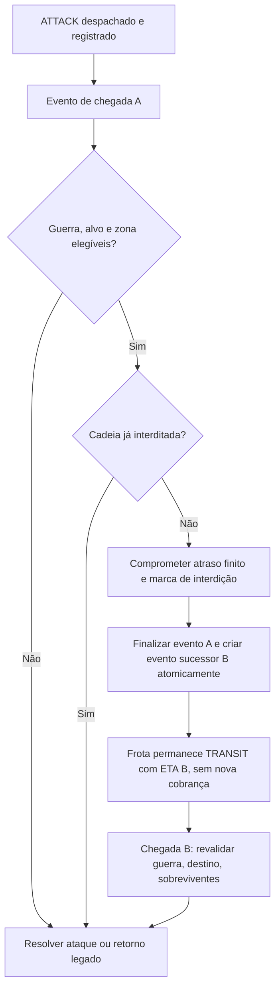
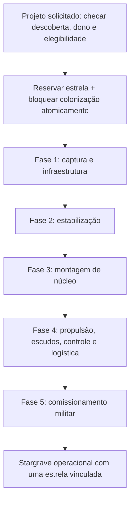

# STARZ — C3.0-D07: contratos técnicos de persistência, eventos e Stargrave

**Estado:** `APPROVED` **como contrato técnico de design** em 08/11/2026: decisões **D07-A–H** e cenários **T01–T16** aprovados explicitamente. **Não implementado nem testado.**  
**Base aprovada:** [C3.0-D01–D05](combat-3-decisions.md) e [C3.0-D06 A–H](combat-operational-closures.md).  
**Escopo:** estruturas e fronteiras de dados, atomicidade, versões, ordens sucessoras, seleção determinística de alvos, estados estelares, API futura, migração segura e testes de aceitação.  
**Limite da aprovação:** a especificação define obrigações de versão, atomicidade, idempotência, unicidade e compatibilidade; **nomes de campos, tabelas, enums, migrações e parâmetros numéricos são candidatos**, não um schema final. Não há autorização para modificar `starz/`, `persistent_data/`, migrations, testes executáveis, frontend, CI, PR, merge ou deploy.

## 1. Autoridade e arquitetura existente (`IMPLEMENTED`)

| Fonte | Comportamento executado hoje | Contrato de integração |
|---|---|---|
| `starz/persistent/service.py:dispatch` | Monta frota real, valida missão, dono e recursos; cria `UniverseOrder(kind='mission')` com `payload` JSONB, `due_at` e `resolved=False` | Armazenar escolhas ofensivas validadas no despacho, sem abrir microgestão por salva |
| `service.py:settle` | Seleciona a primeira ordem vencida `resolved=False`, ordenada por `due_at, id`, chama `resolve`, marca a ordem tratada como `resolved=True` | Interdição deve criar **ordem sucessora**; nunca depender de reabrir `due_at` de uma ordem finalizada |
| `service.py:resolve` | Revalida guerra na chegada, executa `resolve_battle` e monta missão `RETURN` quando necessário | Interdição acontece antes do ataque e **não** duplica retorno, combustível ou saque |
| `starz/persistent/combat.py` | Planos de ambos os lados antes de aplicar perdas, até seis salvas, absorção de escudo real e perdas persistentes | Manter um resolvedor autoritativo, sem projetar Stargrave como Dominion |
| `starz/persistent/intelligence.py` | Observações expiráveis com qualidade 0–3, valor privado, sem atualização retroativa | Interferência só modifica observações novas; logs de EW sem vazamento de tecnologia |
| `starz/db/models.py` | `StarSystem`, `Planet`, `EmpireProgress` e `UniverseOrder` existem, mas não há entidade estelar capturada nem Stargrave executável | Novos vínculos de estrela/projeto/unidade requerem persistência própria |
| `persistent_data/technologies/levels.yaml` | `fundamental_tier_5` ainda exige `military_tier_4`; `stellar_containment` ainda exige `carrier_operations` | Mudanças científicas aprovadas no design só entram após edição executável e validação separadamente autorizadas |

**Risco central:** objetos procedurais podem ser recriados pela geração visual, mas o estado de uma estrela capturada deve vir de dados persistidos exclusivos, não de uma renderização do frontend.

## 2. Fronteiras e fonte única de verdade

1. **Conhecimento**: conclusão em estado científico autoritativo (sem `effects` fictícios). Pesquisa desbloqueia capacidade, mas não a ativa sozinha.
2. **Unidades reais**: naves e defesas já existentes continuam vinculadas ao império, planeta, localização e integridade atuais; EW e interdição não geram versões fantasmas.
3. **Comando/ordem**: intenção autorizada no despacho é congelada em ordem persistente versionada; chegada pode revalidar condições dinâmicas, não reconfigurar escolha do jogador.
4. **Confronto**: um snapshot por lado/salva e um plano de disparos, aplicado uma única vez. Escoltas contabilizam capacidade por `ship_id + salva`.
5. **Estado estelar**: projeto, estrela origem e Stargrave têm vínculo de identidade exclusivo em um registro persistente separado dos hulls e das projeções procedurais.
6. **Observabilidade**: relatório derivado somente de resultados do servidor; visibilidade por jogador, sem consultas arbitrárias ao adversário.

## 3. Contrato de missão `ATTACK` (`APPROVED` como arquitetura; campos candidatos)

**Estrutura conceitual de extensão de `UniverseOrder.payload` (nomes candidatos, não definitivos):**

| Campo candidato | Semântica | Fallback seguro |
|---|---|---|
| `combat_contract_version` | Versão de contrato de regras da missão; número a definir no rollout | Ausente implica comportamento legado |
| `target_doctrine` | `balanced`, `interception` ou `rupture`, selecionada com `fire_control_doctrine` quando necessário | `balanced`, sem ganho retroativo |
| `weapon_profile` | `standard` ou `anti_shield` (exige `shield_disruption`) | `standard` |
| `interdiction_applied` | Registro de que o adiamento já ocorreu nesta cadeia ofensiva | Ausente/falso apenas para ordens compatíveis e elegíveis |
| `mission_chain_id` | Identifica despacho, eventual sucessora e retorno, permitindo deduplicação | Ordens antigas seguem sua semântica existente |
| `originating_order_id` | Referência da ordem de onde surgiu a sucessora, quando houver | Nenhuma para despacho inicial |

**`APPROVED`: versionar e validar a configuração da ordem, com fallback legado. Os nomes são candidatos e não campos executáveis definitivamente aprovados.** A futura implementação deve validar enum, pesquisa, propriedade, participantes, antifraude e compatibilidade. Não reescrever ordens antigas para preenchê-los, nem tratar payload não reconhecido como autorização para ataque especial.

### 3.1. Política de versão e upgrade

- Para missões anteriores: caminho legado, com Equilibrada e armamento convencional; sem EW ou interdição retroativa aplicada a ordens antigas caso isso viole compatibilidade.
- Para missão nova: congelar decisões aprovadas no despacho. Uma mudança posterior de pesquisa ou edição de frota não pode criar uma opção que não existia no lançamento; revalidar requisitos de propriedade e presença na chegada.
- **Decisão `OPEN`:** como revalidar perda posterior de acesso científico (se esse caso puder existir); não introduzir revogação de pesquisa sem contrato.
- Novo recurso deve ser ativado por capability/versão em ambiente de teste depois de aprovação, com rollback que não perde ordens em trânsito.

## 4. Máquina de estados da interdição (`APPROVED` como contrato; sem implementação)

**Atomicidade obrigatória:** registrar a ordem sucessora, atualizar ETA/status da frota e marcar a ordem anterior resolvida em **uma única transação**. A iteração de `settle` não pode ver uma meia-transição.

- Atraso calculado a partir do ETA original do despacho e dos limites em vigor **quando a interdição foi aplicada**; armazenar resultado comprometido, não recalcá-lo a cada tick.
- A mesma cadeia não recebe nova interdição no retorno nem em sucessora. A marca de aplicação segue a cadeia e deve ser verificada no servidor.
- Se já não houver guerra na chegada B, abortar combate conforme contrato de paz atual; a frota retorna conforme combustível já reservado. Não criar `RETURN` adicional para um retorno existente.
- Plataforma `orbital_platform` em modo de interdição não dispara seu armamento; mudança de modo deve ser uma transição válida com energia/tripulação disponível e propriedade comprovada.
- Se o emissor for destruído após a chegada A e antes da B, o atraso já comprometido não é reembolsado; a ordem B não é novamente atrasada.
- Os números **25% do ETA e 30 minutos** são exclusivamente candidatos de balanceamento, não a fórmula final.

**Riscos e mitigação:** loops de chegada no mesmo timestamp, ordem sucessora duplicada, consumo de reserva no retorno, estratégia de atacante esgotar várias plataformas, corrida entre captura de planeta e interdição. Invariantes: ETA estritamente posterior, uma sucessora por evento, zero duplicação de munição/combustível e ordenação estável de eventos.

## 5. Odyssey/EW — contrato de presença e snapshots (`APPROVED` como design)

### 5.1. Emissão

- Emissor é a nave **Odyssey** física elegível pela tecnologia `electronic_warfare` aprovada. Uma Odyssey em trânsito fora do combate não serve a um planeta nem a outra frota.
- Estado necessário por salva: `source_ship_id` elegível; proprietário; localização; pesquisa; status operacional; oposição com sensores/tecnologia adequada. Esses valores derivam do snapshot, não de uma tabela de emissores globais nova.
- Se múltiplos emissores elegíveis: uma fonte determinística (preferir ID estável; ordem ainda `PROPOSED`); sem empilhamento de força. A destruição da fonte durante a salva respeita simultaneidade e só recalcula na salva seguinte.
- Ataque: degradação `specialized → balanced` apenas para seleção efetiva da salva, sem alterar o valor persistente `target_doctrine`.
- Reconhecimento: para uma **nova** observação, qualidade continua em [0..3]; interferência pode reduzir qualidade, sem mudar `expires_at` ou relatórios existentes. Limite de queda de um nível é **hipótese sujeita a teste**.

### 5.2. Separação de informação

O servidor pode conhecer estados privados para **resolver** uma contestação, mas o cliente só vê estados autorizados. Um relatório adversário não revela ID da Odyssey emissora, sua pesquisa exata ou posição de unidades ocultas, exceto se observáveis por uma mecânica legítima.

## 6. Escudos e perfis — contrato de um disparo (`APPROVED` como design)

**Sequência:**
1. Seleção do alvo pretendido pela doutrina autoritativa e eventual degradação EW.
2. Aplicação da escolta automática aprovada pela C3.0-D01, com **uma proteção por escolta por salva** no limite inicial.
3. Definição do alvo efetivo e do modificador de classe **do alvo efetivo**.
4. Aplicação de **um** orçamento de disparo e **uma** unidade de munição se exigida. Aplicar modificador de perfil antiescudo à absorção real, sem criar segundo ataque.
5. Pool de `planetary_shield`, escudo naval e casco/armadura, sem duplicação do pool.
6. Registrar dano de escudo e casco, alvo pretendido, alvo efetivo, doutrina utilizada e redirecionamento quando visíveis.

**Cuidado:** `plans` calcula hoje projeção aproximada, mas `apply_hits` aplica dano efetivo. Antes de implementar novo redirecionamento/antiescudo, definir um modelo de projeção coerente para o **caminho novo**, preservando resultados legados de `balanced+standard` para saves antigos. Os coeficientes antiescudo 1,25× e 0,80× permanecem candidatos, não números aprovados.

## 7. Modelo persistente estelar — obrigações aprovadas e entidades candidatas

| Entidade candidata | Chave lógica | Dados que devem existir | Unicidade/integridade |
|---|---|---|---|
| **StellarSource** (estado do astro) | Universo + ID canônico do sistema + identidade/índice do astro | Estado `available/reserved/captured/contained/disposition_pending`, origem e proprietário de vínculo | **No máximo um vínculo ativo por estrela** |
| **StellarProject** | ID global de projeto + império/universo | Estrela reservada, fase, materiais comprometidos/entregues, progresso, operações e versão | Uma progressão autoritativa por projeto, sem dupla entrega |
| **StargraveUnit** | ID global da unidade excepcional + universo/império | Sistema/posição, estado operacional, mobilidade, HP estrutural, energia, módulos, projeto de origem | **No máximo uma estrela vinculada por unidade**; não é hull convencional |
| **StellarBinding** (ou relação equivalente) | Identidade da estrela + unidade/projeto atual | Tipo de vínculo, ownership, estado de compromisso, transição final | **Uma única relação ativa para cada estrela e para cada Stargrave** |
| **StellarOperation** | ID de operação e token de deduplicação | Extração, estabilização, transporte de módulo, viagem, ataque, destroço e resgate | Eventos únicos, concluídos uma vez, sem itens duplicados |

**`APPROVED` como obrigação:** garantir unicidade/atomicidade e vínculos duráveis. **Não é obrigatório criar cinco tabelas:** a implementação deverá escolher o menor modelo normalizado que imponha restrições transacionais reais. Evitar JSONB desconectado sem unicidade para a fonte estelar. Tabelas/constraints e colunas exatas só poderão ser definidas em migração autorizada.

### 7.1. Identidade da estrela

- Ligar a estrela à identidade durável do sistema existente; não usar apenas coordenadas, nome renderizado ou índice de array da UI. Confirmar no gerador como distinguir astros em sistemas múltiplos **antes** de congelar a chave executável.
- Capturar uma estrela **não** apaga o `StarSystem` nem renumera `Planet`, `planet_index` ou coordenadas. O renderer deve consultar estado persistente de retirada/ausência sem gerá-la novamente como capturável.
- Um sistema **não natal e desabitado** é condição aprovada para iniciar captura. Disputas de colônia/colonização já comprometida precisam ser verificadas sob lock/transação.
- Reservar uma estrela e bloquear colonização deve ser uma **única decisão atômica**; duas requisições concorrentes não podem produzir duas reservas ou uma nova colônia após o compromisso.
- **`OPEN`:** retorno/recuperação da estrela à fonte versus destinação em contêiner seguro; a regra só exige conservar identidade e exclusividade sem destruir mundos automaticamente.

### 7.2. Cinco fases e consumo idempotente

- Cada fase requer pesquisa/infraestrutura habilitadora, condições locais, recursos, módulos reais entregues e tempo; nada avança somente por desbloquear uma descoberta.
- Operações de transporte devem usar identidade física do módulo e reserva real de carga/combustível; uma entrega aceita em um projeto não pode ser reutilizada por outro.
- Falha de pagamento, cancelamento, queda de servidor, nova tentativa ou replay nunca geram dois módulos, duas estrelas ou duas Stargraves.
- O projeto não deve permitir `operational` antes de conclusão de todos os requisitos do comissionamento armado, incluindo `stellar_armaments`. Ciência de captura sozinha não concede meganave armada.
- Hipótese de uma Stargrave operacional **ou em obra** por império é parâmetro de ensaio; não fixar índice de unicidade imperial definitivo antes de decisão quantitativa.

## 8. Stargrave e combate (`APPROVED` como arquitetura, detalhes `OPEN`)

### 8.1. Estados propostos

`building` → `operational` ↔ `damaged` → `incapacitated` → `wreck` → `decommissioned`.

As setas indicam caminhos **conceituais**; recuperação de `damaged` e `incapacitated` para `operational` exige regras de reparo ainda abertas. `wreck` não concede armamentos, transporte, energia de combate ou capacidade operacional.

**Submódulos sem IDs executáveis aprovados:** contenção, propulsão, armamentos, escudos, controle. Persistir integridade e status de cada um; falha degradará capacidades correspondentes. O núcleo estelar conserva vínculo exclusivo e não explode/duplica/teleporta automaticamente.

### 8.2. Integração naval

- Stargrave **não** entra em `persistent_data/ships/functions.yaml` como décimo primeiro hull nem substitui `dominion_hull`. O motor precisa de um **adaptador autoritativo de unidade excepcional**, com alvo/posição/vida reais e HP/módulos próprios.
- Os **seis rounds** e a simultaneidade do combate convencional são invariantes aprovadas; a introdução de módulo estelar não justifica segunda rotina paralela com resultados contraditórios.
- A missão `ATTACK` atual é centrada em planeta; atacar uma Stargrave **móvel** demandará contrato próprio de alvo/posição, sem assumir que `target_planet_id` resolve esse caso.
- Proteger módulos de Stargrave não herda automaticamente a escolta de `Dominion`; futura regra deverá ser autorizada e medida.
- Dano convencional suficiente deve poder incapacitar/derrotar a unidade; `containment_warfare` fornece seleção autorizada de módulo conhecido/exposto, não direito exclusivo de causar dano.

### 8.3. Derrota e destino da estrela

- Transição a `incapacitated` ou `wreck` impede mobilidade, armamento e bônus militares imediatamente conforme regra autoritativa.
- O vínculo `stellar_source_id ↔ stargrave_id` persiste enquanto o núcleo estiver sob resgate, destroço ou disposição pendente. Nada volta a estar `available` até transação segura explícita.
- A disposição final da estrela será um evento único, auditável e recuperável de falha, sem apagar `StarSystem`, `Planet` ou colonos.
- `OPEN`: se salvamento dá direito de posse, se há posse militar do destroço, onde o astro permanece, consequência ambiental, limiar de perda e prazo de reparo.

### 8.4. Decisão posterior C3.0-D08: destino estelar (`APPROVED`)

A [C3.0-D08-A–H](combat-stellar-disposition.md) fechou a direção funcional antes `OPEN`: ao ser derrotada, Stargrave mantém núcleo seguro em destroço, custódia depende de reivindicação e controle militar e os três destinos exclusivos são **reconstrução**, **repatriação física** ou **relíquia selada**. Captura inicial restringe-se a estrela única. A matriz numérica D08-F foi aprovada **somente para ensaios**. A [C3.0-D09](combat-stellar-custody.md) aprova como design transações/fluxos de custódia e critérios T17–T32, **não executados**. A [C3.0-D10](combat-custody-adjudication.md) está `APPROVED` como design de controle regional, disputa de claims e invariantes de unicidade, com T33–T48 ainda não executados. A [C3.0-D11](combat-custody-transfer.md) está `APPROVED` como design de transferência de custódia e âncoras; mobilidade em espaço profundo e schema final ainda `OPEN`.

Essa decisão posterior prevalece sobre descrições históricas de destino totalmente `OPEN` nesta D07, sem aprovar nomes de schema, custódia diplomática ou parâmetros finais.

## 9. Migração, concorrência e rollout futuro

**Documentar antes de qualquer migração executável:**

1. **Versionamento de payloads:** `UniverseOrder` sem novos campos continua funcionando; não requer backfill destrutivo.
2. **Constraints duráveis:** unicidade do vínculo e operações; enforcement no banco/serialização, não só no frontend.
3. **Locks e transações:** reservar estrela/colônia e criar sucessora de interdição dentro de sessão transacional controlada; evitar tick infinito.
4. **Rollback:** impedir novas operações de versão incompatível sem perder ordens iniciadas; tratar migrações adicionando campos/entidades antes de habilitar escrita.
5. **Leituras dual-version:** clientes e serviços devem tolerar estados antigos sem Stargrave; não revogar pesquisa, hull ou save existente.
6. **Feature flag/capability:** separar habilitação científica, validação do servidor e exposição de UI para rollout gradual quando autorizado.

Nenhum nome de migration, coluna, constraint ou endpoint fica aprovado por este documento; somente a exigência de migração **segura** já é parte do design.

## 10. Cenários de aceitação técnica (para futura implementação)

| ID | Cenário | Resultado exigido |
|---|---|---|
| **T01** | Ordem legado `ATTACK` sem campos novos | Resultado convencional e retorno, sem interdição retroativa indevida |
| **T02** | Doutrina+perfil congelados no despacho | Reprocessamento mantém escolhas originais, sem alterar o tempo da ordem |
| **T03** | Odyssey destruída na salva | Efeito respeita simultaneidade; some no próximo snapshot se não houver outra emissora |
| **T04** | Duas Odyssey presentes | Sem empilhamento ilimitado; resultado determinístico |
| **T05** | EW versus sensores superiores | Interferência contestada, sem bloquear disparos |
| **T06** | Perfil antiescudo contra gerador planetário | Consumo real uma vez, sem criar dano extra nem usar pool duas vezes |
| **T07** | `orbital_platform` no modo interdição | Zero disparos convencionais da plataforma na mesma condição |
| **T08** | Chegada A interceptada | Uma sucessora B, ETA posterior, sem segunda cobrança/retorno duplicado |
| **T09** | Sucessora B sob mesma zona | Sem novo atraso; paz durante viagem impede ataque |
| **T10** | Duas capturas simultâneas da mesma estrela | Uma reserva bem-sucedida e outra recusada atomicamente |
| **T11** | Colonização concorrente à reserva estelar | Nunca coexistem captura comprometida e colonização nova inválida |
| **T12** | Falha no transporte de módulo | Não há consumo/entrega duplos ao retomar |
| **T13** | Stargrave derrotada sem `containment_warfare` | Dano convencional funciona em cenário preparado |
| **T14** | Stargrave vira destroço | Não pode mover, disparar ou reaparecer; vínculo estelar persiste |
| **T15** | Tick offline, replay e reset de sessão | Exatamente uma resolução por evento, resultados estáveis e save preservado |
| **T16** | Dados de inteligência adversária ocultos | Logs e UI não revelam nível tecnológico ou fonte de EW não observada |

Os cenários **T01–T16** estão **`APPROVED` como critérios de aceitação técnica**; complementam B01–B18 da [C3.0-D04](combat-balance-plan.md). **Nenhum foi executado**.

## 10.1. Atualização posterior — dispensa de saves legados de desenvolvimento

**Decisão explícita posterior do responsável (08/11/2026):** não é necessário preservar compatibilidade com **saves legados descartáveis de desenvolvimento**. Os parágrafos históricos desta D07 sobre fallback de payloads antigos, dual-version, backfill e manutenção dos saves antigos **não são mais requisitos para desenvolvimento em banco isolado e descartável**. A implementação futura poderá usar um contrato único limpo e instalação reprodutível do zero, mediante autorização expressa para o banco-alvo.

**Continuam obrigatórios:** propriedade, autenticação, identidade única da estrela, integridade de recursos, transações atômicas, idempotência do novo estado, replay offline e proteção de bancos compartilhados. A dispensa **não é autorização para reset/descarte** de qualquer banco real. Ver [D12](combat-implementation-plan.md) (`PROPOSED`).

**Atualização dos critérios de QA:** T01/T15 continuam válidos quanto a execução determinística, reentrada e recuperação, mas os testes de *migração de saves anteriores* podem ser substituídos por **instalação limpa e persistência correta do novo contrato**, sem retirar testes de idempotência e multiusuário.

## 11. Registro das oito decisões D07 aprovadas

| ID | Contrato `APPROVED` como design |
|---|---|
| **D07-A** | `UniverseOrder.payload` de ataque versionado, com doutrina/perfil congelados no despacho e fallback legado |
| **D07-B** | Interdição atômica por ordem sucessora B e marca por cadeia, sem mudança retroativa da ordem A |
| **D07-C** | Odyssey presente como emissora, uma fonte efetiva determinística e snapshots por salva |
| **D07-D** | Um orçamento por disparo, alvo pretendido/efetivo e absorção real sem duplicação de escudos |
| **D07-E** | Estado estelar/projeto/unidade e vínculo 1:1 com restrições de unicidade e exclusividade transacional |
| **D07-F** | Máquina de estados Stargrave com destroço persistente e disposição da estrela separada |
| **D07-G** | Alvo excepcional móvel via adaptador de combate, sem criar `hull` fictício ou alterar missões legadas |
| **D07-H** | Estratégia de migração/versionamento/rollback e cenários T01–T16 antes de qualquer rollout |

**`APPROVED`:** D07-A–H e os cenários T01–T16 foram aprovados expressamente em 08/11/2026. **`OPEN` após a aprovação:** schema e nomes finais, origem de identidade em sistemas binários, coeficientes EW/escudos/interdição, duração e custos, propriedade de destroços, possibilidade de resgate, efeitos estelares no planeta, limites por império e testes quantitativos.

## 12. Referências e separação de responsabilidades

- [Aprovações C3.0-D06](combat-operational-closures.md); [registro Combat 3.0](combat-3-decisions.md).
- [Plano de balanceamento](combat-balance-plan.md), [Research 3.0](research-3.md), [Stargrave](stargrave.md), [defesas](defenses.md).
- [Motor de combate](../../starz/persistent/combat.py), [missões](../../starz/persistent/service.py), [inteligência](../../starz/persistent/intelligence.py), [modelo de ordens](../../starz/db/models.py).
- [Política de QA local](../development/local-qa.md), [instruções de repositório](../../AGENTS.md).

**Aprovação expressa dos contratos de design e dos cenários de aceitação não equivale a autorização de implementação.** Nenhum YAML, código, banco, teste de gameplay, PR ou merge foi modificado por esta aprovação.
