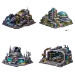

# STARZ 3.0 — Planetary building visual concepts (alpha v0.1)

**Art only.** Initial AI-generated isometric pixel-art concepts for four distinct facilities, intended for UX evaluation on the `Instalações` screen. Not integrated into the game and not the complete building catalog.

## Assets

- `buildings-atlas-64.webp`: RGBA WebP atlas, 128 × 128 px; four 64 × 64 cells (transparent backgrounds). This is a lightweight, low-resolution preview for Codex to inspect.
- High-resolution working originals were prepared separately and are not committed to this branch.

| Building | Code | Atlas cell (x, y, w, h) |
| --- | --- | --- |
| Ferrite Extractor | `ferrite_extractor` | `0, 0, 64, 64` |
| Civil District | `civil_district` | `64, 0, 64, 64` |
| Planetary Research Center | `planetary_research_center` | `0, 64, 64, 64` |
| Orbital Shipyard | `orbital_shipyard` | `64, 64, 64, 64` |

## Visual direction

3/4 isometric pixel art; dark gunmetal sci-fi architecture, readable silhouettes, cyan lighting, warm amber utility lights, no baked-in labels. Preserve current STARZ gameplay and data contracts. No recommendations for what the player should build.

## Implementation guidance for Codex

This branch is based on an older remote checkpoint **only to share art safely**. The local `experiment/persistent-universe` checkout has newer, unpushed commits. Do **not** reset or merge the older branch into the working checkout. Instead:

1. `git fetch origin art/building-assets-alpha-v1`
2. Inspect `frontend/public/assets/buildings/concepts/buildings-atlas-64.webp` and this README.
3. If the visual concept is approved, extract atlas cells or cherry-pick just the asset commit onto the local development branch.
4. Do not alter mechanics, database or existing UI until explicitly requested.

This is an art reference/prototype, **not** a complete UX implementation.
